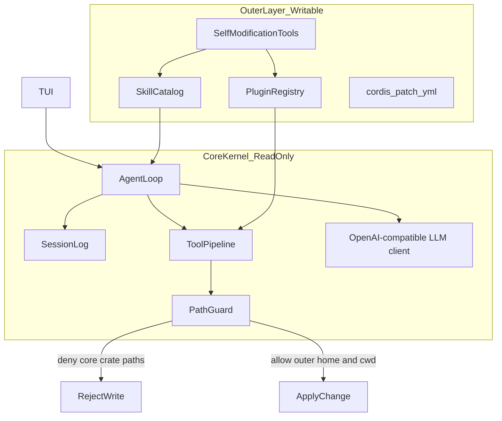

> **上游文档归档**：保留基线提交 `71dbb7d07d0ef20eaf708f15aca967d1b02bd8fb` 的使用说明供开发者参考。当前项目入口和社员使用方式见 [README.md](README.md)。

# dsh-rust

用 Rust 重写的 [DeepSeek Harness](https://github.com/deepseek-ai/deepseek-harness) 风格编程助手：**终端里就能对话、改代码、跑命令**，提供 CLI、终端界面、网页工作台和 Windows 原生桌面端，模型默认走 DeepSeek。

> 仓库：[`deepseek-harness-rust-optimize`](https://github.com/Ar1haraNaN7mI/deepseek-harness-rust-optimize)

---

## 安装后在任意目录使用

先克隆仓库并安装一次。需要 Rust/Cargo、Python 3 和 Node.js 22.12+：

```bash
git clone https://github.com/Ar1haraNaN7mI/deepseek-harness-rust-optimize.git
cd deepseek-harness-rust-optimize

python scripts/install_dsh.py
```

安装器编译 release 版 `dsh` 和网页资源，安装到 `CARGO_HOME`（未设置时为 `~/.cargo`）。Windows 会在需要时补充用户 PATH；如果安装器提示 PATH 已更新，请重新打开终端。macOS/Linux 按安装器提示将安装目录的 `bin` 加入 PATH。

之后在任何项目目录运行，当前目录就是 DSH 的工作区：

```powershell
dsh login                  # 保存模型凭据；只需配置一次
dsh                        # 当前目录打开 TUI
dsh --startup              # 播放启动动画后进入 TUI
dsh startup next on        # 只在下一次交互启动播放
dsh web --startup          # 当前目录启动网页 Harness
dsh app --startup          # 当前目录打开 Rust 原生桌面窗口
dsh -C "D:\projects\demo"  # 显式选择另一个工作区
```

`dsh web` 默认使用已安装的网页资源，打开 `http://127.0.0.1:8770/`，不需要回到源码目录或手动传 `--assets`。用户名、凭据和一次性启动设置仍保存在用户目录；当前项目的技能、插件和文件范围随工作目录切换。没有 Key 也能先打开界面，真正发消息前再用 `/apikey` 配置即可。

项目专属配置可以放在 `.dsh-rust/config.toml`，或通过 `--config <路径>` 指定。旧的 `config/default.toml` 只有包含 DSH 的 `[llm]` 和 `[paths]` 配置表时才自动加载，避免误读其他项目的同名文件。显式指定的配置和专属配置有误时仍会报错。

`dsh web` 在交互终端启动后会自动打开默认浏览器。如果端口已有 DSH Harness，先询问是否直接打开现有页面；选否后再询问是否关闭旧服务并在当前工作区重新启动；再次选否则返回第一问。输入 `y`/`n`（或“是”/“否”），Ctrl+C 退出。复用时沿用旧服务的工作区，重启时使用当前工作区；`--startup`/`--no-startup` 会传给本次打开的页面。`--no-open` 禁止自动打开浏览器。非交互调用遇到占用会直接返回错误，可通过 `--port` 选择其他端口。

网页左下角「设置」提供可搜索的设置中心：主题、通知、个人资料、模型与自定义指令、记忆管理、归档会话、数据导出、权限和启动偏好。模型服务配置、插件和 Skills 启停、任务执行、Git 差异审查均连接真实 DSH 运行时，详情见 [DSH 设置中心](docs/harness-settings.md)。


更新时在源码仓库 `git pull` 后再次运行 `python scripts/install_dsh.py`。也可从任意目录使用安装脚本的绝对路径。`--root <目录>` 指定安装位置，`--debug` 安装调试版。

### Windows 桌面端

`dsh app` 使用 Rust 的 Tao 窗口与 Wry / WebView2 渲染真实 TSX Harness，安装器同时安装无控制台入口 `dsh-desktop.exe`。聊天、模型凭据、文件、技能、插件与权限操作复用 CLI 的真实 Runtime；启动动画、固定英文旁白和个人档案使用同一套资源。系统需要 Microsoft Edge WebView2 Runtime（通常已随 Windows / Edge 安装）。目前原生窗口支持 Windows，其他平台继续使用 `dsh web`。

```powershell
python scripts/install_dsh.py --desktop-shortcut --desktop-workspace "D:\projects\demo"
dsh app --startup                       # 动画结束后进入桌面工作台
dsh -C "D:\projects\demo" app          # 明确选择工作区
dsh app --port 0                        # 使用空闲端口
dsh-desktop --startup                   # 无控制台入口，也支持全局参数
```

首次默认尝试端口 8770；已有相同工作区的 DSH 服务时直接复用，其他工作区或其他程序占用时自动选择空闲端口，并记住该工作区的端口以保留界面偏好。同一工作区再次启动会聚焦现有窗口。显式 `--port` 不会自动改用其他端口。关闭桌面窗口只回收本窗口创建的服务，复用的网页服务仍然可用。外部链接在默认浏览器打开。桌面端的界面偏好保存在独立 WebView 用户目录，DSH 模型配置和会话仍与 CLI 共用。

### 网页与桌面端的身份和访问密码

进入工作台后，在 **设置 → 个人资料** 修改 **访问身份、档案编号、访问密码**。密码默认不设，首次可直接进入；设置后，动画的身份卡提供真实密码输入，验证通过才读取本地能力并进入工作台。关闭或跳过动画时使用同一套密码验证；设置中也可以立即锁定、修改或移除密码，修改和移除需要当前密码。

访问密码为 8–128 个字符，Rust 后端只在当前 `outer_home/web-access.json` 保存带随机盐的 Argon2id 校验值，不返回密码或校验值。解锁会话最长 12 小时，服务重启或修改密码后需重新验证；浏览器与桌面 WebView 各自验证。访问身份和编号沿用 `startup-profile.json`。终端保持现有启动流程，不增加密码输入或登录步骤。

此功能属于 Rust Harness 的本机网页／桌面入口。官方 DSH 的单独动画扩展继续沿用官方登录，不修改官方账号验证。

### 原生电脑操作（Windows，三端共用）

在 **设置 → 电脑操作** 开启后，可以选择真实窗口、读取控件和截图，并点击按钮、填写文本、发送按键或滚动。终端、网页和桌面端共用 Rust 的 Windows UI Automation / 输入后端，**不依赖安装 Codex、浏览器扩展或额外的自动化服务**。此功能默认关闭，开启状态保存在当前 `outer_home/settings.toml`。

```powershell
dsh computer status                 # 查看是否启用、平台支持和可用工具
dsh computer enable                 # 为后续终端和当前配置启用
dsh computer windows                # 列出可见窗口及 window_id
dsh computer observe <window_id>    # 读取真实控件，返回本机截图路径
dsh computer session                # 持续 JSON 控制会话，保留观察与操作上下文
dsh computer disable                # 停止接受新的电脑操作
```

在普通 DSH 对话中，可要求“读取窗口列表，查看指定窗口并填写其中的文本框”。模型会使用 `computer_list_windows`、`computer_observe` 和 `computer_act`；操作沿用已有审批策略，`read-only` 模式禁止点击或输入。网页和桌面端的手动按钮直接执行你选择的操作。每次动作需要指定窗口和当前观察编号；观察最多保留 60 秒，执行一次动作后需要重新观察，窗口移动、控件变化或目标关闭时会返回真实错误。

DSH 在实际桌面上显示独立的透明、鼠标穿透光标层，只移动自己的箭头，不移动系统鼠标或主动切换前台。操作后 5 秒隐藏，关闭功能、取消或锁定入口时立即隐藏。设置中的预览用于核对画面，不是唯一的操作表面。优先通过 UI Automation 读取真实控件并按控件编号操作，本地 Windows OCR 只补充截图中的文字与位置。

当前模型读取的是**真实的可访问性文字树与本地 OCR 的文字、坐标**；截图供你核对，不伪装成模型视觉输入。OCR 使用 Windows 本机识别引擎，无需额外多模态 API Key；引擎或语言不可用时会说明原因，保留已有控件观察。识别在已遮挡密码区域的截图上进行。截图保存在 `outer_home/computer/screenshots`，只保留最近 20 张由此功能生成的图片。

后台输入优先使用已验证的标准 Win32 按钮／编辑控件消息，其他目标可使用窗口定向坐标消息。消息发送成功不等于应用业务动作完成：模型需要重新观察并核对结果；拒绝后台输入、自绘游戏或受保护窗口不保证可操作。不支持时返回真实原因，不自动切换为控制你的鼠标。Windows 权限更高的窗口、最小化窗口和无法截图的表面也会显示明确错误。

开发联调可运行 `dsh computer session`，逐行发送 `{"action":"list_windows"}`，再用返回的真实编号发送 `{"action":"snapshot","window_id":"…"}`。后续 `invoke`、`set_value`、`click`、`type_text`、`key`、`scroll` 都需要该会话内的 `window_id` 和 `snapshot_id`；控件调用、文本输入、按键和滚动还需 `node_id`。坐标使用窗口内的物理像素。坐标点击自绘区域后，只有观察结果实际返回 `input_target.node_id: "background"` 才能向该目标发送文本、按键或滚动；投递结果标为 `unverified`，须重新观察确认。滚动值为 -10 到 10 的非零滚轮步数，正值向上。不支持任意位置的系统鼠标或全局快捷键注入。关闭设置会注销本实例的模型工具并取消排队操作；其他已运行的 DSH 实例会在下一次操作前检查已保存的关闭状态，工具列表在查询状态、更新设置或进入下一模型步骤时刷新。

当前版本尚未集成浏览器 DOM/CDP 适配或视觉模型。结构化控件与操作后的状态回读是主要依据；OCR 不保证识别所有图标或复杂画布，桌面独立光标也不等于目标软件一定接受后台操作。

### 蓝色大肥鱼

在「设置 → 宠物」选择 **DeepSeek 大肥鱼**。网页和桌面端直接使用 [deepseek-fat-fish-codex-pet](https://github.com/gmskywalker/deepseek-fat-fish-codex-pet) 的原始精灵图集与帧布局，提供待机、工作、等待确认、完成与出错动作；点击或键盘激活会回应，减少动态效果时保持静态帧。旧的猫咪开启偏好自动迁移到大肥鱼，原本关闭则继续关闭。

原资源作者说明、固定版本和 SHA-256 位于 [`web/public/pets/deepseek-fat-fish`](web/public/pets/deepseek-fat-fish)。该资源保留上游的非官方同人声明，不将其重新标注为本项目的 MIT 资产。桌宠显示在工作台侧栏及设置预览中。

开发者仍可在仓库根目录直接运行 Cargo：

```bash
cargo run -p dsh-cli -- --startup
```

`cargo run` 是源码开发命令，需要找到仓库的 `Cargo.toml`；日常跨目录使用 `dsh`。

---

## 它能做什么

| 场景 | 怎么用 |
|------|--------|
| 交互改代码 | `dsh` 进入 TUI，直接打字 |
| 一次性任务 / CI | `dsh exec "修复 lint 错误"` |
| 继续上次对话 | `dsh resume --last` |
| 代码审查 | `dsh review --uncommitted` |
| 诊断环境 | `dsh doctor` |
| 启动动画预览 | `dsh startup` |
| Windows 电脑操作 | `dsh computer enable` 后在对话中指定目标窗口 |

TUI 里常用：

- **Enter** 发送 · **Alt+Enter** 换行 · **Esc** 取消当前回合
- **鼠标点击** 对话区 / 输入框切换焦点 · **滚轮** 滚动对话
- **`/help`** 看全部斜杠命令 · **`/keymap`** 看快捷键
- **`!command`** 后台跑 shell · **`@path`** 提到某个文件

---

## DSH 启动动画（可选）

### 两套可切换的视觉风格

设置 → **外观**（或**启动动画**）可选择 **莱茵生命风 UI** / **拉特兰风 UI**，选中后自动保存。独立高清预览按 **C** 打开设置，同样可以切换。密码验证前的选择先用于本次预览，验证成功后自动保存；重新读取身份资料不会切回旧风格，保存失败可点击“重试保存风格”。风格统一保存在本机 `startup-profile.json` 的 `visual_style` 字段，网页、Rust 桌面端与 CLI 共用；旧资料默认保持莱茵生命风。修改姓名、档案编号或播放开关不会重置风格。

网页与桌面的嵌入开屏继承本次播放开始时的界面明暗设置；播放中在动画设置里切换明暗会立即生效，莱茵序章也支持浅色纸底。资料刷新不会重新装载正在播放的开屏。独立预览可通过 `?theme=light` 或 `?theme=dark` 指定初始明暗，不会改变已保存的 UI 风格。

- **莱茵生命风 UI / DELTA CIRCUIT**：保留原有三角 DSH 字轨徽章、黑白实验室档案、橙色标记与机械光阑。
- **拉特兰风 UI / CONCORD**：原创等半径相交圆、三联尖拱与衬线 DSH 铭文徽章；以一朵直立鸢尾为主花，配合放射圣印、花窗、交织结绳、雕版角饰与菱形刻纹。珠白／冷蓝线稿逐层构造，身份页的几何轮廓直接重组成书脊，随后封面、叠页和正文依次展开；曲线页首、内凹书沟、露出的封皮与书签共同形成扁平书册。其余场景连续衔接，等待确认后继续播放不会重新拆散构图；读取到完成保留同一本书，只加入结果印记。设计研究参考 [几何与神学的碰撞](https://www.bilibili.com/video/BV17iGR6nEh9/) 和 [众生行记 UI／交互／动效记录](https://www.bilibili.com/video/BV1WFkwBJEhR/)，未使用游戏素材、原视频或原标志。

两套风格都读取真实身份和本机 Skills／Plugins，使用既有英文阶段旁白，保留密码验证、减少动态效果与任意位置交互。网页标志、浏览器页签图标、Rust 桌面窗口／任务栏图标随选择更新；终端下次启动读取相同选择，仅显示资料，不增加密码输入。Windows 固定快捷方式文件保留通用 DSH 图标。

```bash
dsh startup profile --visual-style laterano  # 拉特兰风；下次播放生效
dsh startup profile --visual-style rhine     # 切回莱茵生命风
dsh app --startup                           # Rust 桌面端
dsh web --startup                           # 网页端
```

独立预览的 `?style=laterano` 可在未连接本地服务时演示新风格；连接后以真实保存的资料为准。原创轮廓分别位于 `docs/startup-emblem.js` 和 `docs/startup-laterano-emblem.js`，运行 `node scripts/export_startup_emblem.cjs`、`python scripts/export_desktop_icon.py` 可重新生成匹配的 SVG、终端轮廓与 Windows 图标。

拉特兰高清背景的日轮、月牙、星座连线、八芒星、环十字与三叶结饰由 [`docs/startup-laterano-ornaments.js`](docs/startup-laterano-ornaments.js) 原生绘制。浅冷灰底承托纯白窗瓣、月牙、星片和纸叶，细蓝线勾勒轮廓；深色版保留白色纹饰与深色正文页，维持清晰的文字对比。身份页采用长直柱、短尖券、双联窗棂与分层拱框构成轻盈的教堂窗式轮廓。日轮分瓣归拢、月牙带伴星回旋、星链逐段汇流；进入能力书页时，它们与窗棂一同沿连续路径收向书脊，再展开成页扣、页边星链和印记，保持扁平构成。背景按实际标题、身份卡和清单边界避让；缩小窗口优先保留主体和可读正文，减少动态效果时直接呈现完整构图。网页、Rust 桌面端与下文的官方 DSH 独立插件均使用同一份高清资源。


### 桌面、网页与 TUI 如何使用

**Rust 桌面端与网页端共用同一套高清动画**：两者都使用 `StartupSurface` 加载同一份启动页面、Canvas 图形、文字动效、音频和真实本地读取接口。花纹的构造、重组与切幕一致，无需分别选择或维护两份设计。身份卡、密码输入和 Skills／Plugins 清单始终保持可读，装饰按实际边界避让。


各幕分别采用上下对向展开、径向生长、沿圆弧落位与环向锁合。入场结束后，部分纹章仍自主运转：日轮白瓣分层反向旋转，月牙轻摆、伴星绕行，星链上的节点沿轨道巡行，花窗与冠饰保持缓慢的内部运动。文字、身份卡、书页和主鸢尾花保持稳定；日月成为页扣后也只转动内部纹样。确认节点仍保留这些环境动效，按 **P** 可暂停这些运动、再按恢复；页面进入后台时也会停止，减少动态效果时呈现静态构图。身份页向书页交接会保留上一帧实际绘制的转角。

真实读取期间，印章停靠书缘，书外轨道与交替扫描表示忙碌状态；结果确定后，印章再沿登记动作展开到真实留白。逐条返回清单不会让印章在正文间跳位。分支数量来自实际返回的能力清单，装饰纹样的自转不代表读取进度，不用循环动画虚构读取百分比。

能力档案的左页显示 Skills，右页显示 Plugins。尖拱与柱头先聚合到书脊，藏蓝封皮展开后，三层纸叶错拍跟进，再揭开正文。身份页两侧的几何印记沿书缘迁入两页，继续展开成玫瑰窗与八角交织纹章；复合边饰、页眉和印章错拍归位，保持平面线稿与实色块的构成。装饰避开真实清单的标题、名称和来源；大印章只占用清单下方的实际留白，长清单占满书页时转为窄边饰。舞台标题使用贴合字形的细描边，背景尖拱与章号保持连续。正文不拉伸，长清单可分别滚动；加载结果返回时书页保持展开，已显示的名称不会重复入场。减少动态效果时直接呈现完整书册。

字号、卡片与书页留白采用同一套响应式比例，小窗口保留可读下限，大窗口限制装饰的最大尺寸。密码验证前后身份卡保持等高；验证成功保留短暂确认后，尖拱、柱头、卡片角标与行刻度沿连续路径重组为书脊、缝线和页边，旁白未结束时仍会等待。播放中改变窗口比例不会重置构建进度，源图形等比迁移，正文按新窗口尺寸重新排版。

书页线稿以连续路径合并绘制，完成的文字复用字形分段结果；多个尺寸或滚动通知合并到下一帧更新，避免重复测量与绘制。可用 `node scripts/test_startup_laterano.cjs --benchmark` 查看本机的几何运算和绘制调用量；该诊断不是浏览器帧率承诺。


上图为独立预览的未连接状态；连接本地 DSH 后，两页显示该实例实际返回的清单。

**TUI 使用单独绘制的终端版本**：通过 Ratatui 的 Braille 点阵构建相交圆、鸢尾纹章、花窗与尖拱，按终端空间重新安排六幕和展开节奏，读取真实已加载能力快照。它沿用同一个 DSH 徽章与风格选择，不嵌入网页；窄终端会简化纹饰，终端不增加密码输入。

终端拉特兰版的构图顺序是 **等圆定基 → 鸢尾展开 → 玫瑰窗构造 → 拱门展开 → 登记归序 → 印记归一**，基础时长为 13.8 秒；身份与真实能力清单仍随阶段显示，交互与旁白等待会延长停留。`1 / 2 / 3`、`← / →` 调整视觉焦点，`Enter / Space` 或左击确认节点，`Esc` 跳过。


上图为实际 Ratatui 渲染帧，使用测试身份与能力清单；日常运行显示当前实例的真实资料及已加载清单。

在命令行切换 TUI 风格并立即预览：

```bash
dsh startup profile --visual-style laterano  # 保存拉特兰风
dsh startup                                # 交互预览，不创建会话
dsh startup --auto --silent                 # 自动、静音预览

dsh startup profile --visual-style rhine     # 保存并切回莱茵生命风
dsh startup                                # 预览旧版
```

选择风格与开启动画是两件独立的事。选择会持久保存，并供桌面、网页及 TUI 共用；修改风格不会自动开启每次启动动画，也不会修改用户名、档案编号或密码。无需重开终端窗口，新风格在下一次播放时使用。`--theme dark|light` 仅切换明暗配色，不会切换莱茵／拉特兰风。

```bash
dsh --startup                   # 本次播放所选风格，然后进入 TUI
dsh startup next on             # 仅下次 TUI 交互启动播放
dsh startup next off            # 仅下次 TUI 交互启动跳过
dsh app --startup               # 桌面端：同一套高清版
dsh web --startup               # 网页端：同一套高清版
dsh startup web                 # 独立高清预览；按 C 打开设置并切换风格
```

TUI 风格指令保存到当前配置解析出的 `outer_home`。使用多个独立配置时，可把 `--config <路径>` 放在 `startup` 前，为对应实例切换。旧资料默认保持莱茵生命风；官方原生 DSH 扩展的安装与独立配置见下方说明。

### 演出与交互

设置了访问密码后，每次打开或重播高清启动动画都需要重新输入密码。已有浏览器登录会话不会自动代替本次验证；点击空白处、跳过、拖动进度或切换章节都不能越过身份页。无法读取访问设置时停留在身份页，可点击“重新检查访问设置”重试。纯静态离线预览仍可演示，但不能用于解锁网页或桌面端。

内置原创电影式启动序列：**厂牌唤醒 → 本地连接 → 个人档案 → 技能与插件清单 → 加载结果 → 欢迎进入 DSH**。莱茵版原创 DELTA CIRCUIT 平面徽章以三角形为主体：左侧 D 字轨、底部 S 折线与右侧 H 连接共同形成轮廓，内部保留小型 DSH 刻字和三层扫描线。分件飞入、高速环扫、平面扫描与档案展开保持扁平风格。高清版没有底部控制栏，按 C 或点右上角省略号打开设置。

这一版以 [RhineLabUI](https://github.com/LBEILC/RhineLabUI) 的档案解密和扫描节奏为视觉研究参考，重新编排原创的三层徽章刻度环、错拍锁块、六瓣平面光阑、校准导轨、斜线版纹与三组斜切转场。外围能力分支由实际返回的 Skills／Plugins 生成，只有读取中才出现流动载波。启动画面中的标题、字标、提示、字幕、档案与真实清单统一使用固定文字单元内的滚动、逐字显现、乱码锁定和遮挡条撤回；参考源码与时间采样实现见 [`docs/startup-text.js`](docs/startup-text.js)。徽章轮廓共用同一个中心和缩放，橙色角标直接跟随实际卡片边框，外围装饰避让实际身份卡，适配窗口尺寸与缩放。中文采用随包提供的工业排版与 Noto Sans SC 字体子集，字体及许可证位于 [`docs/assets/fonts`](docs/assets/fonts)。动画没有复用参考项目的图形或采样音频，支持减少动态效果设置。

动画**默认关闭**。启用后在开场、个人档案、加载结果三个节点等待确认；莱茵版等待时保持环扫，拉特兰高清版等待时保留日月与纹章的环境运动，终端拉特兰版则保持已完成的构图。加载指示仅在真实读取期间运行。确认后连续播放两幕，再到下一节点；终端最后自动进入对话，`dsh web` 的嵌入动画完成或跳过后进入真实 Harness，`dsh startup web` 独立预览停留在欢迎画面。莱茵版基础演出为 **13.8 秒**，拉特兰高清版为 **20.4 秒**；交互等待、真实读取和较长旁白会延长停留时间，不截断声音。终端独立预览可用 `--auto` 完整自动播放。

编排参考 [dsh-startup-screen 的序列与确认机制](https://github.com/6shenhonghong9/dsh-startup-screen/blob/main/lib/splash.js)。本项目的字徽、图形部件及电子音效自行绘制和合成。旁白使用预先生成的固定英文录音，统一称呼 **OPERATOR**，只说明实际阶段，不念自定义用户名、变化的数量或逐项技能／插件名。动画等待每句播完；失败与部分失败使用独立的提示录音。运行时不调用系统 TTS，也无需加载语音模型。音频无法播放时仍保留画面和电子音效。

固定旁白由 Qwen3-TTS 的参考音色生成流程制作（不是单独微调模型），模型版本、参考片段与英文台词记录在 [`docs/assets/voice/manifest.json`](docs/assets/voice/manifest.json)。[`scripts/generate_startup_voice.py`](scripts/generate_startup_voice.py) 可重新生成；[`scripts/sync_startup_voice.py`](scripts/sync_startup_voice.py) 校验并同步终端内嵌音频。生成环境仅用于制作资产，不是 CLI 运行依赖。

高清版通过 `dsh startup web` 启动，浏览器打开命令输出的本机地址（默认 `http://127.0.0.1:8769/startup-preview.html`）。HTML、JS 和徽章已嵌入 CLI，无需额外前端运行时。直接用静态服务器打开 [`docs/startup-preview.html`](docs/startup-preview.html) 只能观看离线演出，会明确显示未连接本机数据。

网页的中间段会调用与 DSH 相同的 `SkillCatalog` 与 `PluginRegistry`，实际读取目录、解析技能、编译校验插件并挂载技能／工具定义，实时传回名称、来源、成功与失败项。最终数量取自加载完成后的目录，包含插件附带技能，空目录显示零；不会用动画时间伪造百分比。独立预览保留自己的注册表，不创建会话、不启动调度器或热更新、不执行插件工具。正常 TUI 启动已在动画前加载目录，因此终端展示的是本次启动**已加载**的快照。两者都不假称完成模型推理或远程鉴权。

用户名与编号由网页设置保存，或使用 `startup profile` 命令；存储在当前 `outer_home/startup-profile.json`，网页与终端共用。未保存时使用系统用户名。切换 `--config` 或 `outer_home` 可以使用不同身份。

```bash
dsh --startup                           # 本次播放后进入真实 TUI 会话
dsh resume --last --startup              # 播放后继续上次会话
dsh web --startup                        # 启动动画后进入本机 Harness 网页
dsh web --port 8870 --assets web/dist     # 显式指定开发构建目录
dsh startup                              # 单独预览，不创建会话
dsh startup web                          # 高清版 + 真实本机加载接口
dsh startup web --port 8877               # 指定本机端口
dsh startup profile --name CatShark       # 保存自定义用户名
dsh startup profile                      # 查看已保存身份
dsh startup next on                      # 仅下次交互启动播放
dsh startup next off                     # 仅下次交互启动跳过
dsh startup --theme light                 # 浅色实验室主题
dsh startup --interactive                 # 三个节点点击 / Enter 确认（默认）
dsh startup --auto                        # 自动播放；等待旁白读完
dsh startup --auto --speed 1.5 --silent    # 加速、静音自动预览
dsh --no-startup                          # 本次直接进入 TUI
dsh --silent                             # 保留动画，关闭启动音
```

在三个确认节点，**任意位置鼠标左击 / Enter / Space** 都能继续。播放中点击或按 Enter 只注入可见的能量脉冲，不跳段、不打断音画；**1 / 2 / 3** 或 **← / →** 可随时改变视觉焦点，无需操作固定选项表单。终端支持左击；拖动效果属于高清浏览器版。随时可用 **Esc** 跳过、**Ctrl+C** 退出、**M** 切换静音。`--auto` 与 `--interactive` 互斥。独立预览无需 API Key；`exec`、`--json`、MCP 与 app-server 等非交互入口不会播放启动动画。

`--startup` 只为本次交互启动启用动画，完成或按 Esc 跳过后进入会话；它也适用于 `tui`、`resume`、`fork`、`app` 和 `web`。`web` 在本机端口 8770 提供 Harness 页面，优先读取可执行文件所在安装目录的 `share/dsh/web`，没有安装资源时尝试当前目录的 `web/dist`；显式 `--assets` 始终优先，路径错误会直接报错。网页复用真实 Runtime、会话、技能与插件；`startup web` 仍是独立动画预览。非交互命令即使带 `--startup` 也不会播放动画。

`startup next on|off` 保存一次性选择；只有下一次成功进入受支持终端的交互启动才会消费它。预览、网页、非交互命令、重定向输出或启动失败都不会消费。消费后恢复配置文件的长期设置；显式 `--startup` / `--no-startup` 优先于该选择，但本次合格的终端启动仍会消费它。两个旗标不能同时使用。多个 CLI 同时启动时，同一选择只会由一个进程取得。

### 开屏等待、重播与故障恢复

默认序章、身份和能力确认三个节点需要点按或 `Enter`；背景装饰持续运动表示交互待命，不代表动画又从头播放。终端可用 `--auto`，网页可按 `C` 切换连续播放；访问密码仍需验证。独立 `startup web` 预览完成后停在终幕，再次点按才重播；`web` / `app` 中的开屏完成后进入工作台。

网页音频初始化最多等待 2 秒，单段旁白下载与解码最多等待 10 秒；音频设备中断、结束事件丢失时，旁白在音频时长加 2 秒后停止（上限 30 秒），视觉流程继续。本地能力读取最多等待 120 秒，超时显示失败，不伪造成功。工作台启动时的身份状态与初始化请求最多等待 10 秒，超时提供重试，不以超时替代密码验证。

官方动画插件在挂载前记录本次播放，同一服务、同一标签页播放中刷新也不会重播；重复注入不会再叠加动画层。会话存储不可用时跳过可选开场，独立的「返回 Harness」按钮可在子页无响应时退出，官方登录照常生效。

遇到旧版卡住或反复开场，更新源码后重新运行 `python scripts/install_dsh.py`；仅使用官方插件则重新运行 `python scripts/install_native_startup.py`，然后重启对应服务。故障回归：`node --test scripts/test_startup_liveness.cjs`，宿主生命周期检查：在 `web` 目录运行 `npm test`。

### 官方原生 DSH：单独安装动画

如果使用的是 [DeepSeek 官方 Harness](https://github.com/deepseek-ai/deepseek-harness)，可只安装动画扩展，**不需要编译本 Rust 项目**。需要 Python 3.9+（仅打包安装时）和 **Node.js 22.19+（22.x）或 24+**。扩展固定使用已验证的官方 `@deepseek-ai/dsh@0.2.0-rc.2`，官方程序及依赖由 npm 一并安装。新命令叫 `dsh-native`，与现有官方／Rust 的 `dsh` 并存。

首次安装：

```bash
git clone https://github.com/Ar1haraNaN7mI/deepseek-harness-rust-optimize.git
cd deepseek-harness-rust-optimize
python scripts/install_native_startup.py

dsh-native startup profile --name CatShark
dsh-native startup profile --visual-style laterano
dsh-native web --startup
```

安装后可以从任意项目目录运行。动画直接覆盖在官方网页上，结束／跳过后回到官方页面；不是另一个模拟的 Harness。其加载段向官方运行时借用**当前默认 Agent 预设的真实作用域**，读取该工作区的 Skills，以及实际运行中的主机和默认预设插件；不会创建会话或执行模型任务。官方登录 Cookie、跨域限制与本地写入令牌均保留。

```bash
dsh-native startup enabled on      # 长期启用，默认关闭
dsh-native startup next on         # 下一次打开本机官方网页时播放
dsh-native startup next off        # 下一次打开时跳过
dsh-native web --no-startup         # 本次强制跳过
dsh-native web --port 3081          # 官方网页参数原样传递
```

原生版的一次性选择在**启动成功后首次打开经过官方登录的本机网页**时消费；`--no-open` 等待手动打开，帮助、配置导出和非 Web 命令不消费。显式开关优先，但也消费该次选择。配置独立保存在 `$DSH_HOME/startup-animation`（默认 `~/.dsh/startup-animation`），不修改 Rust 用户资料。同一服务、同一浏览器标签页从首次挂载起即记录播放，完成前后刷新都不会重复演出。

更新：在同一分支 `git pull` 后再次运行 `python scripts/install_native_startup.py`。卸载：`npm uninstall --global @dsh-rust/native-startup`，现有 `dsh` 及用户数据保留。离线传递安装包：`python scripts/install_native_startup.py --pack-only` 会在 `target/native-startup-package` 生成含动画、英文音频、字体和许可证的 `.tgz`；其他电脑通过 `npm install --global <该文件路径>` 安装，首次仍需从 npm 获取官方依赖。`--prefix <目录>` 可指定隔离安装位置。

**支持范围：官方 `web` / `--profile web`，仅本机浏览器。** 官方此版本没有提供 TUI 预设，因此原生扩展不虚构终端界面；本项目 Rust CLI 的终端演出仍使用 `dsh --startup`。Electron Desktop、远程托管和自定义原生预设不在此扩展范围内。完整安装、更新、卸载和接口说明见 [`integrations/native-startup/README.md`](integrations/native-startup/README.md)。

### Rust 版长期设置

长期设置放在 `config/default.toml`，也可以用 `--config <路径>` 读取自己的配置：

```toml
[tui.startup]
enabled = false         # 改为 true 后每次交互启动播放
sound = true
volume = 0.35           # 0.0 到 1.0
speed = 1.0             # 0.25 到 3.0；越大越快
theme = "dark"          # dark / light
interactive = true     # 在三个节点点击 / Enter 确认；false 则自动播放
reduced_motion = false # true 时显示静态启动画面
```

`--startup`、`--no-startup` 与 `--silent` 只影响本次运行，默认仍关闭动画。音频设备或播放后端不可用时，动画仍可继续。

其他 Rust 代码也可设置下次启动行为，无需启动代理或调度器：

```rust
pub fn enable_next_boot(config: &dsh_core::AppConfig) -> anyhow::Result<()> {
    dsh_core::set_next_startup(&config.resolve_outer_home()?, true)
    // 传 false 即可让下次启动跳过。
}
```

一次性选择保存在当前 `outer_home` 的 `startup-next.txt`，由交互 TUI 原子消费。`set_next_startup` 只设置偏好；`take_next_startup` 供启动流程取得并消费偏好。

---

## 两层架构（为什么更稳）



| 层 | 内容 | 可变性 |
|---|---|---|
| **Core** | agent-loop、session 事件日志、tools waterfall、LLM 客户端、PathGuard、内置工具（read/edit/shell/skill） | 编译进二进制；运行时 **禁止** 模型改 `crates/`、`Cargo.toml`、可执行文件自身 |
| **Outer** | `~/.dsh-rust/` 与工作区 `.dsh-rust/`：plugins、skills、`patch.yml`、自动标签索引 | 模型可通过工具增删改；热加载；失败隔离 |

```text
dsh-rust/
  Cargo.toml
  crates/
    dsh-core/      # session, events, agent-loop, system-prompt
    dsh-computer/  # Windows UI Automation、窗口截图与原生输入
    dsh-llm/       # OpenAI-compatible streaming + tools
    dsh-tools/     # tool registry + pre/execute/post waterfall
    dsh-fs/        # fs + PathGuard
    dsh-plugin/    # outer plugin load/unload/hot-reload + tags
    dsh-skill/     # dual-format skill discovery + progressive load
    dsh-tui/       # ratatui chat / tools / plugins pane
    dsh-protocol/  # versioned task/event/cloud wire contracts
    dsh-app-client/ # reconnecting JSON-RPC client + event cursor
    dsh-cli/       # `dsh` binary: tui | headless | plugin | skill
  outer/           # seeded outer templates (safe defaults)
  config/default.toml
  README.md
```

- **内核**不会被模型改坏：`crates/`、`Cargo.toml` 等写入会被 PathGuard 拒绝。
- **外层**可热扩展：插件（Rhai）、Skills（OpenAI `SKILL.md` + DeepSeek 风格）、会话、学习权重都在用户目录。
- 外层变更先写入临时目录 → 校验 → 原子替换；失败则保留上一版。插件在 **Rhai 沙箱**中执行，危险能力只能经 core 已注册宿主工具代理。

---

## 安装要求

- Rust 当前 stable（本次在 **1.95.0** 验证；依赖版本由 Cargo.lock 固定）
- DeepSeek API Key（[开放平台](https://platform.deepseek.com/)）
- 可选：Git（`/diff`、`dsh review` 会用到）

Key 存放位置（**不要提交到 Git**）：

- `~/.dsh-rust/credentials.env`（推荐：`cargo run -p dsh-cli -- login`）
- 或环境变量 `DEEPSEEK_API_KEY`
- 本地/兼容后端也可使用 `DSH_LLM_API_KEY` / `OPENAI_API_KEY`
- 或本地 `.env`（已在 `.gitignore`）

---

## 常用命令

开发时用 `cargo run -p dsh-cli -- …`；若已 `cargo build --release`，把前缀换成 `./target/release/dsh`（Windows：`.\target\release\dsh.exe`）即可。

```bash
cargo run -p dsh-cli                                    # 交互 TUI（默认）
cargo run -p dsh-cli -- "帮我看看这个仓库"               # 启动并自动发送第一句
cargo run -p dsh-cli -- exec "列出所有 TODO"            # 非交互（别名：e）
cargo run -p dsh-cli -- exec --json "..."               # NDJSON 事件流
cargo run -p dsh-cli -- resume --last                   # 恢复最近会话
cargo run -p dsh-cli -- session list
cargo run -p dsh-cli -- skill list
cargo run -p dsh-cli -- plugin list
cargo run -p dsh-cli -- doctor                          # 环境自检
cargo run -p dsh-cli -- config security-research on     # 授权网安研究模式
cargo run -p dsh-cli -- events --follow --json     # 持续消费 durable event 流
cargo run -p dsh-cli -- cloud import ./change.patch   # 导入可审计补丁
cargo run -p dsh-cli -- cloud list                    # 列出补丁 artifact
cargo run -p dsh-cli -- apply art-... --dry-run       # 经 PathGuard 预览应用
cargo run -p dsh-cli -- app-server --listen 127.0.0.1:4567  # TCP 控制面
cargo run -p dsh-cli -- -h                              # 完整 CLI 帮助
```

TCP app-server 可通过 `DSH_APP_SERVER_TOKEN` 启用认证；客户端在首次
`initialize` 请求的 `auth_token` 参数中提交同一 token。监听非 loopback
地址时建议始终设置该变量。

Cloud artifact 也可以通过远程 app-server 管理；`--server` 只改变
artifact 的读取/导入位置，最终写入仍发生在运行 `dsh apply` 的本地工作区：

```bash
dsh cloud list --server 127.0.0.1:4567
dsh cloud import ./change.patch --server 127.0.0.1:4567
dsh apply art-... --server 127.0.0.1:4567 --dry-run
```

应用前会校验 artifact 记录的 canonical workspace identity 与当前工作区一致；
如果远端是另一份 checkout，请先在目标工作区重新导入补丁，避免把合法补丁
误写到错误的目录。

TCP 客户端在断线后会重新执行 `initialize`，并自动重试幂等读取与事件
long-poll；创建任务、审批、artifact 导入等有副作用请求不会盲目重放。
事件消费者使用 sequence cursor，因此进程重启后可从最后交付的事件继续。

DSH 全局旗标：

```bash
cargo run -p dsh-cli -- -m deepseek-v4-flash -s workspace-write -a on-request "小改动"
cargo run -p dsh-cli -- --yolo exec "在沙箱外放开手脚跑（慎用）"
```

| 旗标 | 含义 |
|------|------|
| `-m / --model` | 模型，如 `deepseek-v4-pro` / `deepseek-v4-flash` |
| `-s / --sandbox` | `read-only` · `workspace-write` · `danger-full-access` |
| `-a / --ask-for-approval` | `never` · `on-request` · `untrusted` |
| `--add-dir` | 额外允许的目录 |
| `-C / --cd` | 先切换工作目录再启动 |
| `--startup` | 本次交互启动播放动画，然后进入 TUI 或 Harness 网页 |
| `--no-startup` | 本次跳过启动动画 |
| `--silent` | 本次关闭启动音效 |

---

## TUI 斜杠命令（精选）

输入 `/` 后按 **Tab** 可补全。

| 命令 | 作用 |
|------|------|
| `/help` `/help all` | 帮助（分主题：`session` `agent` `ui` `keys`…） |
| `/apikey` `/logout` | 配置 / 清除 API Key |
| `/model` `/permissions` `/approval` `/sandbox` | 模型与权限 |
| `/new` `/clear` `/resume` `/fork` `/compact` | 会话管理 |
| `/plan` `/review` `/diff` `/status` | 计划、审查、差异、状态 |
| `/ps` `/stop` | 后台终端 |
| `/vim` `/raw` `/sidebar` `/keymap` | 界面 |

完整列表见 TUI 内 `/help all`。

---

## Skills 与插件

**Skills** 自动扫描（OpenAI 标准 + DeepSeek/dsh）：

- 项目：`.agents/skills/`、`.dsh/skills/`
- 用户：`~/.dsh-rust/skills`、`~/.agents/skills`
- 仓库示例：`outer/bundled-skills/`

**Plugins** 外层 `plugin.yml` + Rhai，安装到 `~/.dsh-rust/plugins`。

```bash
dsh plugin list
dsh plugin add ./outer/plugins/echo-plugin
dsh plugin marketplace add owner/repo
```

---

## 配置与数据目录

| 路径 | 内容 |
|------|------|
| `config/default.toml` | 默认模型、PathGuard、TUI、CTM |
| `~/.dsh-rust/settings.toml` | 权限、主题、审批策略等 |
| `~/.dsh-rust/sessions/` | 会话记录 |
| `~/.dsh-rust/features.toml` | Feature flags |
| `~/.dsh-rust/mcp.toml` | MCP 服务器 |
| `~/.dsh-rust/hooks.toml` | 生命周期 hooks |
| `~/.dsh-rust/rules/` | execpolicy 规则 |

小于 70B 的模型会在 `llm.optimization.mode = "auto"` 下自动走紧凑策略：减少工具 schema、限制上下文和工具结果、降低单回合步数/输出 token、默认串行工具调用并关闭 thinking；通过 `parameter_count_b` 或 `DSH_MODEL_SIZE_B` 可覆盖模型别名的自动判断。MCP 之外还支持 Ollama、llama.cpp server、LM Studio、vLLM、SGLang、LiteLLM、LocalAI、TGI 和 MLX-LM 等开源 OpenAI-compatible 后端，并支持有序 fallback 与 provider-specific `extra_body`；详见 [`docs/small-models.md`](docs/small-models.md)。

```bash
cargo run -p dsh-cli -- debug backends
cargo run -p dsh-cli -- debug model-profile
cargo run -p dsh-cli -- --backend ollama -m qwen2.5:14b "检查测试"
cargo run -p dsh-cli -- --backend lm_studio -m qwen2.5-14b-instruct "检查测试"
cargo run -p dsh-cli -- --model-size-b 14 --model-optimization small "检查测试"
```

示例规则：`outer/rules/default.toml`
检查：`dsh execpolicy check --rules outer/rules/default.toml --pretty -- rm -rf /tmp/x`

`security-research` 默认开启，用于已授权范围内的网安分析、漏洞复现、逆向和流量自动化：模型不会因为“网安”标签追加泛化拒答或法律免责声明。它只影响模型提示文本，不会绕过权限模式、审批、PathGuard、沙箱或审计；可用 `dsh config security-research off` 或 TUI `/security-research off` 关闭。

---

## 开发

```bash
cargo run -p dsh-cli              # 日常启动（推荐）
cargo run -p dsh-cli -- doctor
cargo build -p dsh-cli            # 仅编译
cargo build -p dsh-cli --release  # 发布产物
```

Workspace crates：`dsh-core` · `dsh-computer` · `dsh-llm` · `dsh-tools` · `dsh-fs` · `dsh-skill` · `dsh-plugin` · `dsh-tui` · `dsh-protocol` · `dsh-app-client` · `dsh-cli`

---

## 安全提示

- 不要把 API Key 写进仓库或截图进 README。
- `read-only` / `on-request` 适合日常；`--yolo` 仅在隔离环境使用。网安研究模式不会改变这些运行时边界。
- 内核路径受 PathGuard 保护；外层变更失败可回滚，不拖垮主循环。

---

## License

MIT（见仓库 `license` 字段 / 后续 LICENSE 文件）。

灵感与语义对齐：[deepseek-ai/deepseek-harness](https://github.com/deepseek-ai/deepseek-harness)。交互体验参考 [OpenAI Codex CLI](https://developers.openai.com/codex/cli/slash-commands)。
