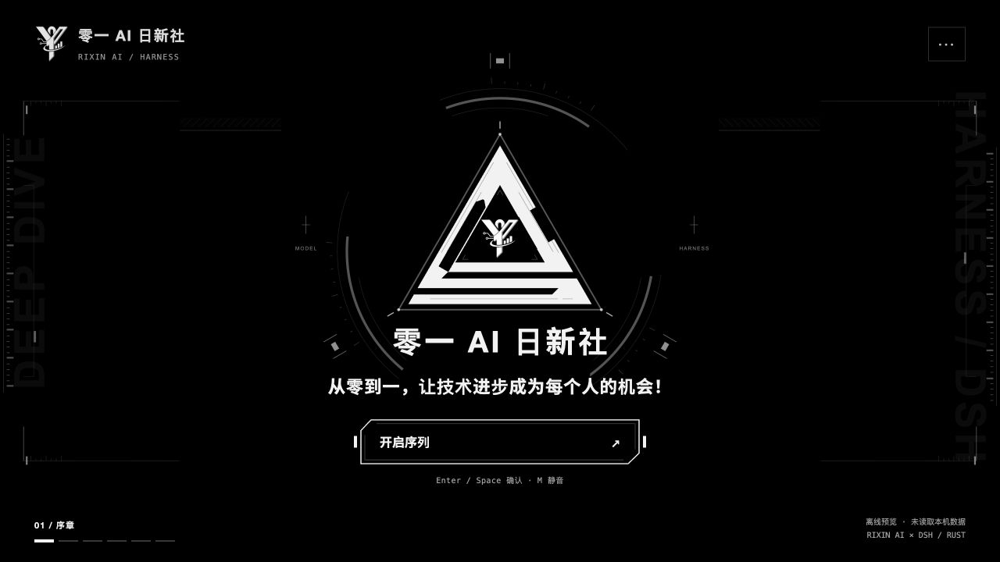

<div align="center">

<h1>◈ 零一·棱光序章</h1>

<p><strong>零一 AI 日新社 · 专为社员制作的 DSH 开场动效</strong></p>
<p>为每一次打开工作区，留下一段属于日新社的开场。</p>
<p>◇ 三角几何 &nbsp; · &nbsp; ◎ 银灰徽记 &nbsp; · &nbsp; ♫ 机械音效</p>

<p>
  <a href="#purpose">🧭 项目主旨</a> &nbsp; · &nbsp;
  <a href="#quick-start">🚀 快速开始</a> &nbsp; · &nbsp;
  <a href="https://github.com/XiaoSiKe/01-lingguang-prologue/releases/latest">📦 社员下载</a> &nbsp; · &nbsp;
  <a href="README-RIXIN.md">🛠️ 工程说明</a>
</p>

</div>

---

<a id="purpose"></a>

## 🧭 项目主旨

> **从零到一，让技术进步成为每个人的机会！**

我们希望，AI 与技术的进步能走进每位社员的日常：帮助学习，支持探索，让一个想法有机会成为作品。

「棱光序章」把这份初心放进打开 DeepSeek Harness（DSH）的第一刻。三角几何逐步成形，日新社的银灰徽记随之显现，为接下来的一次编程、一次尝试、一次创造拉开序幕。希望社员每次开启工作区，都能带着好奇，从一件具体的事开始，走出自己的从零到一。

## 🖼️ 开场一览



<p align="center"><sub>实际运行的深色离线预览 · 三角几何构造与日新社原始银灰 Logo</sub></p>

离线预览仅展示动效，连接、身份、Skills 和插件清单会明确显示真实数据不可用。

---

<a id="quick-start"></a>

## 🚀 社员快速开始

在 **[Release 下载页](https://github.com/XiaoSiKe/01-lingguang-prologue/releases/latest)** 获取 `lingguang-prologue-v0.1.8.zip` 社员使用包，解压后进入目录。使用包已包含开场资源、预览入口与桌面安装脚本。

| 想做什么 | 从这里开始 |
| :--- | :--- |
| 🎬 先体验完整开场 | 解压后运行 `npm start`，或在 macOS 双击 `打开零一二创.command` |
| 🖥️ 接入自己的 DSH 桌面版 | 按下方步骤运行桌面安装脚本 |
| 🧩 使用已有插件集成流程 | 下载 Release 中的 `dsh-rixin-startup-0.1.8.tgz` |

### 🎬 先看开场

需要 **Node.js 22.12+**，无需安装 DSH、Rust 或配置模型凭据。

```sh
npm start
```

浏览器打开 **<http://127.0.0.1:4186/>**，点击「开启序列」或按 Enter 开始。macOS 也可双击目录中的 `打开零一二创.command`。关闭预览时，在终端按 Ctrl+C。

### 🖥️ 接入已经安装的 DSH 桌面版

当前桌面接入验证基于 **macOS / DeepSeek Harness Desktop 0.2.1-rc.3**。

| 准备项 | 要求 |
| :--- | :--- |
| DSH 桌面版 | 先打开一次以初始化桌面配置，再完全退出应用 |
| Node.js 与 npm | Node.js **22.19+（22.x）或 24+**，并安装 npm |
| Python | Python 3 |

在解压后的使用包或源码目录运行：

```sh
python3 scripts/install_desktop_startup.py
```

脚本会打包插件、备份现有桌面 profile、安装并启用开场。完成后，重新打开原来的 DSH 应用图标即可体验；开场结束或按 Esc 返回原来的聊天界面。身份卡属于开场资料，账号登录仍由 DSH 负责。

首次接入建议使用安装脚本，它会同时处理备份和开场启用设置。Release 中的 TGZ 插件包供已有插件集成流程使用。

卸载方式、指定桌面 CLI 路径与打包命令见 **[工程与集成说明](README-RIXIN.md)**。Windows / Linux 的桌面接入尚未实机验证；跨平台离线预览可直接使用 Node.js 启动。

## ✨ 设计与体验

| 组成 | 体验 |
| :--- | :--- |
| ◇ 三角构造 | 延续上游 DELTA CIRCUIT 几何结构，融合日新社原始银灰 Logo，保留其比例和细节 |
| ◐ 黑白视觉 | 以黑、白、中性灰呈现开场，支持深浅色与系统的“减少动态效果” |
| ♫ 机械音效 | 在本机合成马达、伺服、气阀与金属锁扣声，支持静音、暂停和重播 |
| ◎ 六阶段演出 | 序章 → 本地连接 → 身份确认 → 能力读取 → 结果确认 → 从零到一，保留三处确认 |
| ↗ 真实桌面接入 | 通过 DSH 自身的认证连接读取真实身份资料与已加载能力，不发起模型请求 |
| ⤺ 随时返回 | 保留独立返回按钮与资源超时退出机制，结束后回到 DSH |

## ⌨️ 快捷操作

| 操作 | 按键 |
| :--- | :--- |
| 开始或确认当前阶段 | `Enter` / `Space`，或点按画面 |
| 打开 / 收起播放设置 | `C` |
| 暂停 / 继续 | `P` |
| 静音 / 恢复声音 | `M` |
| 重新播放 | `R` |
| 跳过开场 | `Esc`；设置面板打开时先关闭面板 |

---

## 🛠️ 从源码运行

```sh
git clone https://github.com/XiaoSiKe/01-lingguang-prologue.git
cd 01-lingguang-prologue
npm start
```

源码中保留上游 Rust Harness 与 Web 工作台，便于追溯和开发；社员体验开场无需编译这些部分。

| 文档 | 内容 |
| :--- | :--- |
| [工程与集成说明](README-RIXIN.md) | 开发检查、插件打包、桌面集成与运行机制 |
| [产品约定](docs/rixin/PRODUCT.md) | 项目用途、交互与真实数据边界 |
| [视觉约定](docs/rixin/DESIGN.md) | 配色、原始 Logo、三角构造与动效维护 |

## 🤝 来源与致谢

基于 **[Ar1haraNaN7mI/deepseek-harness-rust-optimize](https://github.com/Ar1haraNaN7mI/deepseek-harness-rust-optimize)** 的独立源码副本，基线提交为 `71dbb7d07d0ef20eaf708f15aca967d1b02bd8fb`。感谢上游的启动演出、控制器和集成实现。原始工程说明保存在 [上游文档归档](README-UPSTREAM.md)。

本项目由零一 AI 日新社面向社员定制，是社区开场扩展。DSH 的运行时、模型服务与账号系统由原项目提供。插件代码沿用 [MIT 许可](integrations/native-startup/LICENSE)；社团 Logo 与第三方资源保留各自权利及许可，第三方资源说明见 [资源许可目录](docs/assets/licenses/)。

---

<p align="center"><strong>零一 AI 日新社</strong><br><sub>从零到一，让技术进步成为每个人的机会！</sub></p>
